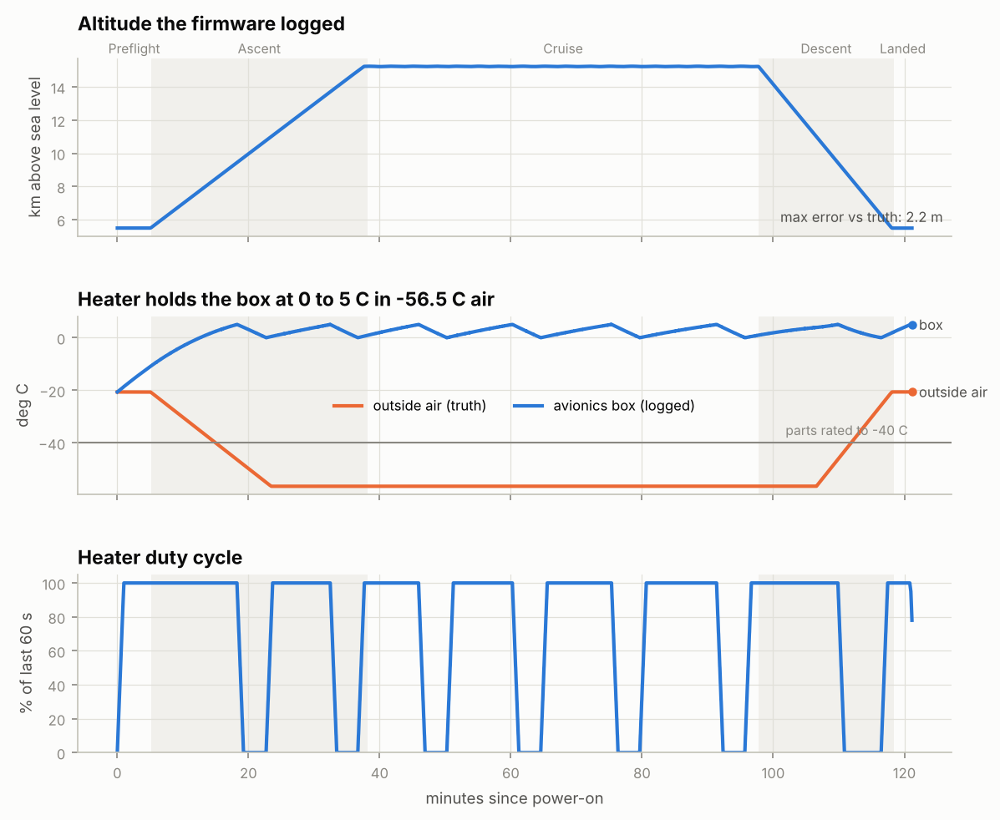
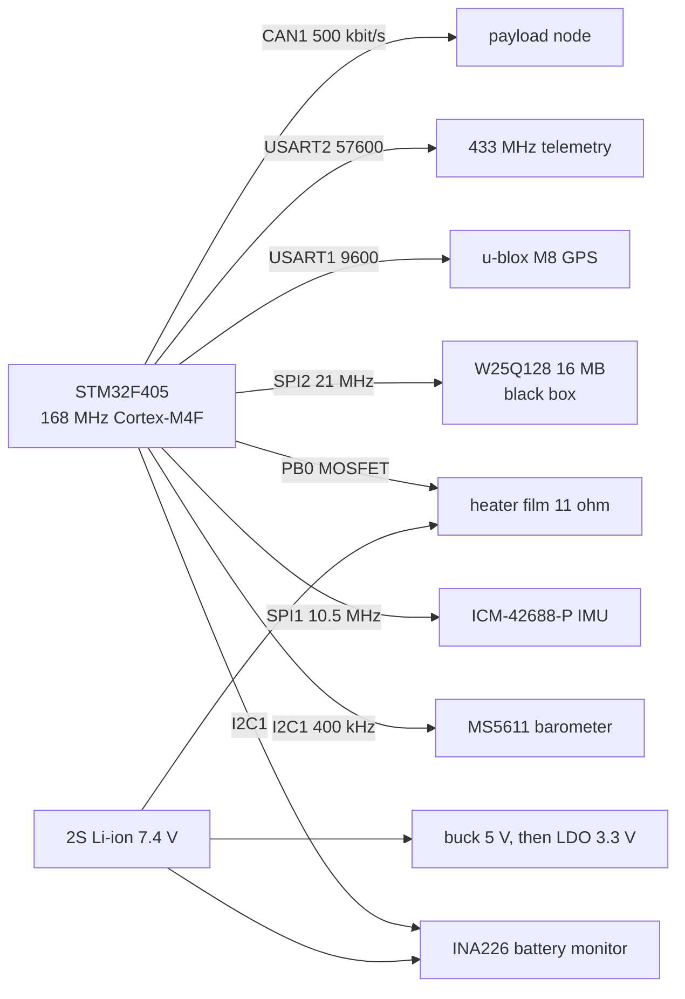
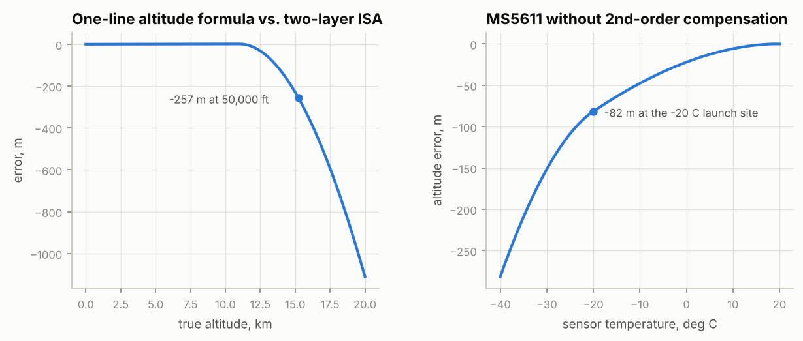
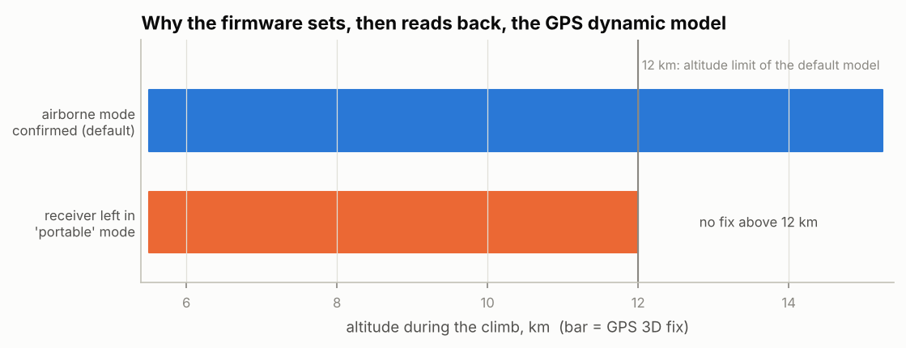
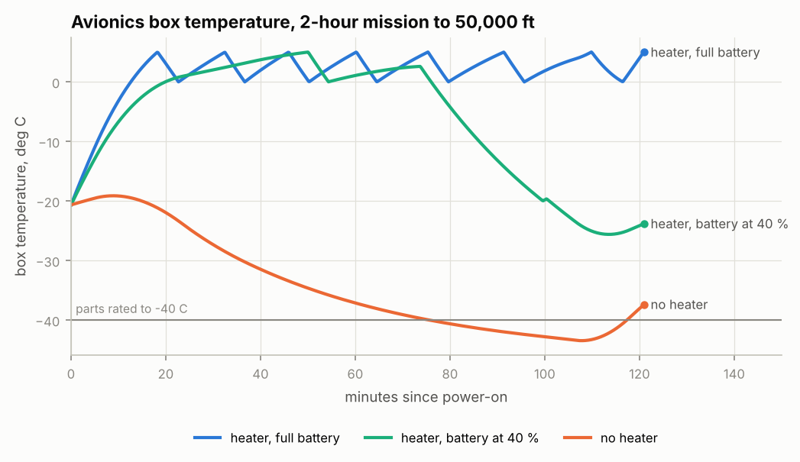
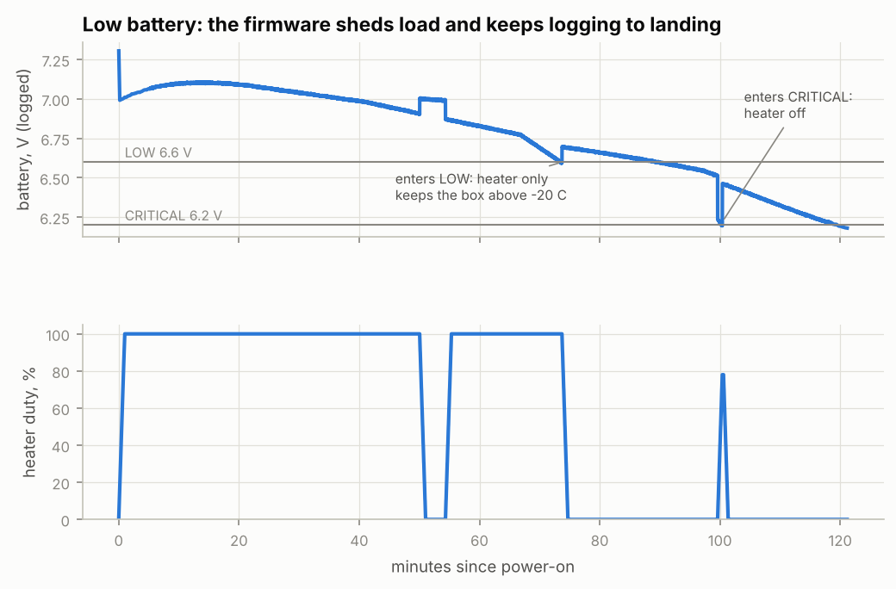

# Vayu: high-altitude UAV avionics firmware + digital twin

[](https://github.com/Naman1821/vayu-avionics/actions/workflows/ci.yml)

Bare-metal **STM32F405** firmware for a UAV sensor and telemetry board that has to work at
**50,000 ft and -56.5 °C**. It uses all four of the usual embedded buses: **I2C** (barometer,
power monitor), **SPI** (IMU, 16 MB flash black box), **UART** (GPS, radio) and **CAN** (payload
node). It also handles the failures that matter up there: brown-outs, a hung CPU, a stuck I2C
bus, a CAN short, sensor dropouts, a cold battery and a GPS that stops working above 12 km.

> **Status, plainly:** the hardware has not been built yet. The firmware cross-compiles for the
> STM32F405 (13.9 KB flash, 2.3 KB RAM). It has been validated in a **software-in-the-loop
> digital twin**: the same application and driver code runs against byte-accurate models of
> each chip, through 11 simulated two-hour flights with injected faults. All 87 automated
> checks pass on every push (CI above). See [Limitations](#limitations-and-next-steps).



## The mission it is built for

Launch from a site at **18,000 ft (-20 °C)**, climb at 5 m/s to **50,000 ft**, loiter for an
hour at -56.5 °C in air with 15 % of sea-level density, descend and land. That is about two
hours. Every scenario below flies this profile.

## The board



| Bus | Device | Why this part |
|---|---|---|
| I2C | MS5611 | Measures down to **10 mbar**. The common BMP280 stops at 300 mbar (~9 km). At 50,000 ft the air is at 116 mbar. |
| I2C | INA226 | Battery voltage and current. Drives the power states and the coulomb counter, and has a hardware under-voltage alert. |
| SPI | ICM-42688-P | Set to ±16 g and ±2000 dps so vibration does not clip it. |
| SPI | W25Q128 | Soldered NOR flash instead of a microSD card: no socket to shake loose and no file system to corrupt. |
| UART | u-blox M8 | UBX binary protocol. **Airborne dynamic model** (the default stops giving fixes above 12 km). |
| UART | 433 MHz modem | CRC-framed status at 2 Hz, events when they happen, and ground commands. |
| CAN | payload node | Heartbeat, altitude and power frames. Automatic bus-off recovery. |

## Things that only go wrong at 50,000 ft (and what the firmware does about them)

| Problem | Size of the error | What Vayu does |
|---|---|---|
| The usual one-line altitude formula only models the lowest layer of the atmosphere | **257 m** wrong at 50,000 ft | Two-layer ISA model (troposphere + isothermal stratosphere) |
| MS5611 needs a second compensation step when cold | **82 m** wrong at the -20 °C launch site if skipped | Full datasheet compensation, including the below -15 °C terms |
| u-blox "portable" mode is limited to 12 km | **No fix at all** above 12 km | Sets airborne mode at every boot, then **reads it back** to prove it stuck |
| Without heat the box settles near -46 °C, below the parts' -40 °C rating | Box falls to -43.5 °C in the simulated flight | A thermostat holds 0 to 5 °C. That costs **84 % of the mission energy** ([budget](docs/POWER_BUDGET.md)) |
| Cold Li-ion cells lose capacity and sag under load | Heater on, voltage dips, heater off, voltage recovers | Power state only gets worse in flight (no LOW/CRITICAL flapping). Loads are shed in order. |



## Fault injection: 11 simulated flights, 87 automated checks

Each check uses only what the firmware wrote to its black box and sent over the radio, compared
against the simulator's ground truth. Full table: [docs/RESULTS.md](docs/RESULTS.md).

| Scenario | What we break | What the firmware does | Measured |
|---|---|---|---|
| `nominal` | nothing | phase detection, ground commands | launch detected 8.1 s after lift-off, altitude error max 2.2 m, GPS fix 100 % above 12 km, in-flight ERASE refused |
| `baro_failure` | MS5611 stops answering at 9 km for 60 s | altitude falls back to GPS, retries every 2 s | detected in 0.11 s, back 0.21 s after it returns, max error 11.6 m |
| `i2c_bus_stuck` | a slave holds SDA low | clocks SCL 9 times, sends STOP, re-initialises I2C | both I2C chips back in 2.4 s |
| `gps_outage` | no satellites for 60 s at 50,000 ft | flags NOFIX, altitude stays on the barometer | reported in 4.9 s, fix back 3.1 s after signal |
| `brownout` | power cut for 300 ms at 13.5 km | PVD warning writes a power-fail record. On reboot it resumes ASCENT from the log and re-configures the GPS. | 0 records lost, airborne mode back in 1.0 s, fix in 2.1 s |
| `cpu_hang` | main loop stops at 50,000 ft | independent watchdog resets the MCU, which resumes CRUISE from the log | reset after 0.50 s, 0.6 s gap in the log |
| `can_bus_off` | CAN-H shorted for 10 s | bus-off reported to the ground, automatic recovery, payload loss flagged | flagged in 0.11 s, recovered 1.0 s after repair |
| `imu_stuck` | IMU data freezes, chip still answers | frozen-sample detector | detected in 1.01 s |
| `gps_rejects_airborne` | receiver refuses airborne mode | read-back catches it, GPS_CONFIG fault | shows the cost: 0 % fix above 12 km |
| `no_heater` | heater disconnected (what-if) | TEMP_LOW fault | box reaches -43.5 °C |
| `low_battery` | battery starts at 40 % | LOW (heater only keeps -20 °C), then CRITICAL (heater off), logging continues | LOW at 74 min, CRITICAL at 100 min, minimum 6.18 V, logged to landing |





Two real bugs were found this way. When the barometer came back after an outage, the firmware
used its last pre-outage altitude for one sample, which was 300 m stale. Separately, the power
state oscillated between LOW and CRITICAL every 9 s because shedding the heater let the voltage
recover. Both fixes are in the code and are covered by the checks above.

## How it is built

```
firmware/app/      the application: scheduler, flight phases, health, heater, power, logger, telemetry, CAN
firmware/drivers/  MS5611, INA226, ICM-42688-P, W25Q128, u-blox UBX (no registers, only hal.h)
firmware/hal/      hal.h: the only interface to hardware
firmware/target/   STM32F405 bare metal: registers from RM0090, startup, linker script, 168 MHz clock
sim/               digital twin: hal.h on simulated chips, atmosphere/thermal/battery physics, scenarios
tests/             unit tests (datasheet examples) and scenario checks
tools/             log decoder, ground station, power budget, plots
docs/              how it works, design decisions, FAQ, power budget, results
```

The trick that makes the digital twin honest is `hal.h`. Everything above it is plain C that
never touches a register. Below it there are two implementations: real STM32 registers, and
models of each chip that answer every I2C, SPI, UART and CAN transaction byte for byte. For
example, the MS5611 model returns raw 24-bit ADC counts, not pressure, so the firmware has to get
the compensation maths right.

Start here: **[docs/HOW_IT_WORKS.md](docs/HOW_IT_WORKS.md)**. Then
[DESIGN_DECISIONS.md](docs/DESIGN_DECISIONS.md), [FAQ.md](docs/FAQ.md) and
[POWER_BUDGET.md](docs/POWER_BUDGET.md).

## Run it

```bash
sudo apt install gcc-arm-none-eabi libnewlib-arm-none-eabi   # for the firmware build
pip install numpy matplotlib

make firmware     # build/vayu.elf for the STM32F405, with a size report
make unit         # 33 unit checks
make scenarios    # 11 two-hour flights, 87 checks, about 30 s
make budget       # docs/POWER_BUDGET.md
make plots        # docs/img/*.png

./build/vayu_sim brownout                                   # one flight -> out/brownout/
python3 tools/ground_station.py out/brownout/downlink.bin   # what the ground saw
python3 tools/decode_log.py out/brownout/flash.bin          # what the black box kept
```

## Limitations and next steps

- **Not run on hardware yet.** The register-level code in `firmware/target/` compiles, follows
  the RM0090 sequences and is reviewed, but the digital twin does not execute it. It replaces
  that layer with chip models. First job on a real board: bring-up against these same checks.
- **No PCB yet.** The pin map is in `firmware/target/hal_stm32f405.h`. The next step is a 4-layer
  KiCad board with a solid ground plane and JST-GH connectors.
- The IMU is read at 100 Hz without its FIFO. A flight controller would use 1 kHz + FIFO + filtering.
- UART transmit is blocking (an ~8 ms stall per status frame). DMA is the fix.
- The mAh counter restarts after a reboot. Keeping it in the battery-backed SRAM is the fix.
- The brown-out reset level is an option byte (BOR level 3, 2.7 V). It should be set once at
  provisioning, not by the firmware.
- The thermal and battery models are simple and documented. They put the firmware through the
  right conditions; they do not predict temperatures to 0.1 °C.

MIT licence.
