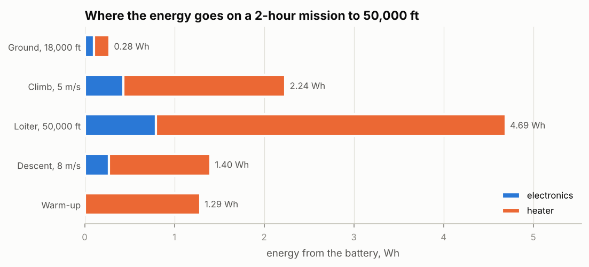

# Power and thermal budget

Generated by `make budget` (tools/power_budget.py). A hand calculation for the 2-hour
reference mission, independent of the simulator, then checked against it. Currents are
typical datasheet values, rounded up: **measure them on the bench before trusting them.**

## Electrical load

| Rail | Part | mA |
|---|---|---:|
| 3.3 V (LDO from 5 V) | STM32F405 at 168 MHz (only used peripherals clocked) | 45.0 |
| 3.3 V (LDO from 5 V) | SN65HVD230 CAN transceiver | 10.0 |
| 3.3 V (LDO from 5 V) | W25Q128 flash (10 page programs/s, otherwise idle) | 0.5 |
| 3.3 V (LDO from 5 V) | ICM-42688-P IMU, 6-axis low-noise mode | 0.9 |
| 3.3 V (LDO from 5 V) | MS5611 barometer, 50 conversions/s at OSR 4096 | 0.6 |
| 3.3 V (LDO from 5 V) | INA226 power monitor | 0.3 |
| 3.3 V (LDO from 5 V) | LED, pull-ups, margin | 7.7 |
| 5 V (buck from battery) | u-blox M8 GPS module (tracking) | 30.0 |
| 5 V (buck from battery) | 433 MHz telemetry modem (RX + 2 Hz TX bursts, average) | 45.0 |

* 3.3 V rail: **65 mA**. The LDO burns (5 - 3.3) V x 65 mA = **111 mW** - fine at this current; a second buck would only pay off above ~200 mA.
* 5 V rail including the LDO: **140 mA = 0.70 W**.
* From the battery through an 88 % buck: **0.80 W** (107 mA at 7.4 V). Buck loss 95 mW.

## Thermal

The box is one thermal mass: 12 mm of foam, then convection to the outside air. Thin air
carries less heat away (convection ~ density^0.6), but at -56.5 C the air is so cold that
the box still loses heat fast.

| | 18,000 ft (launch) | 50,000 ft (loiter) |
|---|---:|---:|
| Outside air | -20.7 C | -56.5 C |
| Air density | 0.698 kg/m^3 | 0.186 kg/m^3 |
| Box-to-air resistance | 11.2 K/W | 12.6 K/W |
| Heater power to hold +2.5 C | 1.28 W | 3.90 W |

* **Without a heater** the box settles at -56.5 + 0.80 W x 12.6 K/W = **-46.5 C**, below the -40 C rating of the parts (the simulator's `no_heater` flight reaches -43.5 C).
* **Heater sizing:** an 11 ohm film gives 5.0 W at 7.4 V and 4.0 W at the 6.6 V LOW threshold, against 3.9 W needed at 50,000 ft. So it can hold 0 C all the way down to LOW; below that the firmware deliberately lets the box cool to -20 C to save the battery.
* **Hot spots:** the LDO dissipates 111 mW (about +22 C in a SOT-23-5 at ~200 K/W), the buck ~0.1 W. With the box at 0..5 C that leaves a large margin to the 85 C rating.

## Mission energy

| Phase | Minutes | Heater W | Electronics Wh | Heater Wh |
|---|---:|---:|---:|---:|
| Ground, 18,000 ft | 8 | 1.28 | 0.11 | 0.17 |
| Climb, 5 m/s | 33 | 3.31 | 0.43 | 1.80 |
| Loiter, 50,000 ft | 60 | 3.90 | 0.80 | 3.90 |
| Descent, 8 m/s | 20 | 3.31 | 0.27 | 1.13 |
| Warm-up of the cold-soaked box (-20.7 to +2.5 C) | | | | 1.29 |

| | Electronics Wh | Heater Wh | Total Wh |
|---|---:|---:|---:|
| Budget (this calculation) | 1.61 | 8.28 | **9.89** |
| Simulator, nominal flight (measured) | 1.61 | 8.05 | **9.66** |

The heater is **84 %** of the energy. At 50,000 ft keeping warm costs more than
everything else on the board combined, which is why the LOW power state throttles it first.

## Battery

2S1P 18650, 3.0 Ah: 21.6 Wh nominal. Usable = 21.6 x 0.9 (cold, box held near 0 C) x 0.8 (end of life) x 0.93 (stop at 3.3 V/cell) = **14.5 Wh**.

* Margin for this mission: **1.5x** (14.5 Wh usable vs 9.9 Wh needed).
* Endurance while loitering at 50,000 ft (4.69 W): **3.1 hours**.
* The simulator's `low_battery` flight starts at 40 % charge: the firmware goes LOW during the
  loiter, CRITICAL during descent, and still logs all the way to landing.

